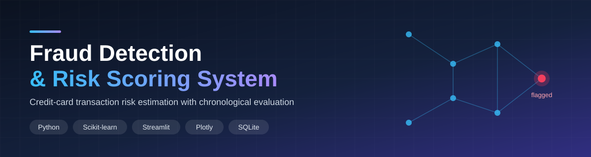
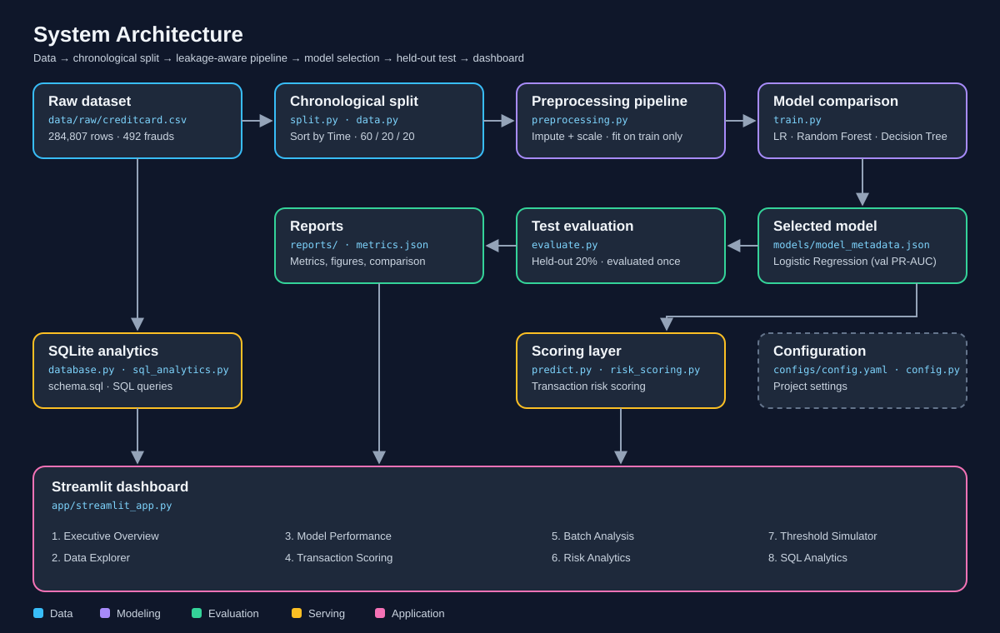

<p align="center">
  
</p>

# Fraud Detection & Risk Scoring System

An end-to-end machine learning application for detecting potentially fraudulent credit-card transactions, evaluating classification performance, and exploring transaction risk through an interactive Streamlit dashboard.

Built with **Python, Pandas, NumPy, Scikit-learn, Streamlit, Plotly and SQLite**.

> **Project type:** Machine Learning Portfolio Project  
> **Dataset:** Kaggle ULB Credit Card Fraud Detection  
> **Best model:** Logistic Regression (selected on validation PR-AUC)

---

## System Flow

<p align="center">
  
</p>

---

## Key Results

| Metric | Test Result |
|---|---:|
| Accuracy | 97.51% |
| Precision | 4.54% |
| Recall | 89.33% |
| F1-score | 8.63% |
| ROC-AUC | 0.9820 |
| PR-AUC | 0.7436 |
| Specificity | 97.52% |
| False positive rate | 2.48% |
| Random baseline PR-AUC | 0.0013 (0.001317, test fraud prevalence) |
| Classification threshold | 0.50 |

**Test set:** 56,962 transactions, including 75 fraudulent transactions.

The model detected 67 out of 75 fraudulent transactions at a classification threshold of 0.50, while generating 1,410 false-positive alerts.

The dataset is highly imbalanced, so PR-AUC, precision and recall provide more useful insight than accuracy alone. A random classifier's PR-AUC equals the fraud prevalence in the test set (about 0.13%), so a PR-AUC of 0.7436 is far above chance.

## Project Overview

This project implements a modular fraud detection and risk analysis pipeline.

It includes:
- Exploratory Data Analysis (EDA).
- Chronological dataset splitting.
- Leakage-aware preprocessing using Scikit-learn pipelines.
- Model comparison and selection.
- Fraud classification and risk scoring.
- Evaluation using classification metrics and visualizations.
- Interactive Streamlit dashboard.
- SQL-based analytics using SQLite.

## Dataset

**Kaggle ULB Credit Card Fraud Detection**

Source: [Kaggle Dataset](https://www.kaggle.com/datasets/mlg-ulb/creditcardfraud)

| Dataset property | Value |
|---|---:|
| Total transactions | 284,807 |
| Fraudulent transactions | 492 |
| Legitimate transactions | 284,315 |
| Features | 30 + target (31 columns) |
| Missing values | 0 |
| File size | ~144 MB (150,828,752 bytes) |
| Target column | `Class` |

Place the downloaded `creditcard.csv` file inside:

`data/raw/creditcard.csv`

The raw dataset is excluded from this repository through `.gitignore`.

## Machine Learning Methodology

### 1. Chronological Data Splitting

Transactions are sorted by `Time` and divided into:

| Split | Share | Transactions | Fraud cases |
|---|---:|---:|---:|
| Training | 60% | 170,884 | 360 |
| Validation | 20% | 56,961 | 57 |
| Testing | 20% | 56,962 | 75 |
| **Total** | 100% | 284,807 | 492 |

This preserves temporal ordering rather than randomly distributing transactions.

### 2. Preprocessing

- Imputation and scaling are performed within model pipelines.
- Preprocessing transformations are fitted using training data only.
- Validation and test data are not used to fit preprocessing transformations.
- No SMOTE or synthetic oversampling is applied.

### 3. Model Comparison

Three classification algorithms were evaluated on the validation set:

| Model | PR-AUC | ROC-AUC | Precision | Recall | F1 |
|---|---:|---:|---:|---:|---:|
| **Logistic Regression** | **0.7719** | 0.9709 | 0.0270 | 0.8947 | 0.0524 |
| Random Forest | 0.7475 | 0.9379 | 0.9512 | 0.6842 | 0.7959 |
| Decision Tree | 0.5905 | 0.8841 | 0.0507 | 0.7719 | 0.0952 |

**Selected model: Logistic Regression**

Selection was based on validation PR-AUC, which is threshold-independent. At the fixed 0.50 threshold, Random Forest shows much higher validation precision but lower recall, so the model ranking depends on the metric and operating threshold used. This is why threshold optimization with explicit business costs is listed as future work.

### 4. Final Test Evaluation

The validation-selected model was evaluated once on the held-out chronological test set (PR-AUC 0.743626, ROC-AUC 0.982026).

| Actual / Predicted | Legitimate | Fraud |
|---|---:|---:|
| Legitimate | 55,477 | 1,410 |
| Fraud | 8 | 67 |

True negatives 55,477 · false positives 1,410 · false negatives 8 · true positives 67.

The results demonstrate high fraud recall but relatively low precision, indicating a substantial false-positive alert burden.

## Application Features

The Streamlit application includes:

1. **Executive Overview** – Summary of fraud detection performance.
2. **Data Explorer** – Dataset exploration and analysis.
3. **Model Performance** – Evaluation metrics and visualizations.
4. **Transaction Scoring** – Transaction risk estimation.
5. **Batch Analysis** – Analysis of multiple transactions.
6. **Risk Analytics** – Fraud and risk distribution analysis.
7. **Threshold Simulator** – Interactive classification threshold exploration.
8. **SQL Analytics** – Database-backed analytical queries.

## Screenshots

Screenshots are not included yet. Launch the app locally and capture them from the running dashboard; this project does not claim screenshots of an unlaunched UI.

## Project Architecture

```text
fraud-detection-risk-scoring/
│
├── app/
│   └── streamlit_app.py
│
├── configs/
│   └── config.yaml
│
├── data/
│   ├── raw/
│   │   └── creditcard.csv          # not committed (.gitignore)
│   └── processed/
│
├── database/
│   └── schema.sql
│
├── docs/
│   └── INTERVIEW_GUIDE.md
│
├── models/
│   ├── best_model.joblib
│   └── model_metadata.json
│
├── notebooks/
│   ├── 01_fraud_detection_eda.ipynb
│   └── README.md
│
├── reports/
│   ├── figures/
│   │   ├── confusion_matrix.png
│   │   ├── precision_recall_curve.png
│   │   └── roc_curve.png
│   ├── classification_report.txt
│   ├── evaluation_report.md
│   ├── metrics.json
│   ├── model_comparison.csv
│   ├── split_summary.csv
│   └── test_predictions.csv
│
├── src/
│   └── fraud/
│       ├── __init__.py
│       ├── config.py
│       ├── data.py
│       ├── split.py
│       ├── preprocessing.py
│       ├── train.py
│       ├── evaluate.py
│       ├── predict.py
│       ├── risk_scoring.py
│       ├── database.py
│       └── sql_analytics.py
│
├── tests/
│   ├── conftest.py
│   └── test_core.py
│
├── .gitignore
├── MODEL_CARD.md
├── PROGRESS.md
├── README.md
├── requirements.txt
└── RUN_GUIDE.md
```

## Installation and Execution

### 1. Clone the repository

```bash
git clone https://github.com/yash-2999/fraud-detection-risk-scoring.git
cd fraud-detection-risk-scoring
```

### 2. Create a virtual environment

Windows PowerShell:

```powershell
python -m venv .venv
.\.venv\Scripts\Activate.ps1
```

### 3. Install dependencies

```bash
pip install -r requirements.txt
```

### 4. Add the dataset

Download the Kaggle dataset and place `creditcard.csv` inside `data/raw/`.

### 5. Launch the application

```bash
streamlit run app/streamlit_app.py
```

For the complete execution workflow, refer to [RUN_GUIDE.md](RUN_GUIDE.md).

## Testing

Run the automated test suite:

```bash
python -m pytest -q
```

**Current test result:** 7 passed.

## Repository Documentation

| Document | Description |
|---|---|
| [Run Guide](RUN_GUIDE.md) | Installation and execution instructions |
| [Model Card](MODEL_CARD.md) | Model details and limitations |
| [Evaluation Report](reports/evaluation_report.md) | Evaluation methodology and results |
| [Interview Guide](docs/INTERVIEW_GUIDE.md) | Project-related interview preparation |
| [EDA Notebook](notebooks/01_fraud_detection_eda.ipynb) | Exploratory data analysis |

Full metrics are also available in `reports/metrics.json`.

## Limitations and Future Improvements

- The dataset is historical and anonymized.
- Temporal evaluation within this dataset does not guarantee performance on a live transaction stream.
- The dataset does not contain cardholder identity, merchant, geographical or real-time contextual information.
- Model scores have not been calibrated as real-world fraud probabilities.
- The default classification threshold of 0.50 is not claimed to be an optimized operational threshold, and no cost-sensitive operational policy is claimed.
- Manual V1–V28 feature inputs are not meaningful unless generated using the original dataset's feature transformation process.

Potential future improvements include threshold optimization using explicit business costs, probability calibration, model monitoring, and evaluation on newer transaction data.

## Important Disclaimer

This is an academic and portfolio demonstration of machine learning techniques. It is not a production banking fraud detection or financial decision-making system.

---

**Author:** [Yashraj Shinde](https://github.com/yash-2999)

**Repository:** [Fraud Detection & Risk Scoring System](https://github.com/yash-2999/fraud-detection-risk-scoring)
